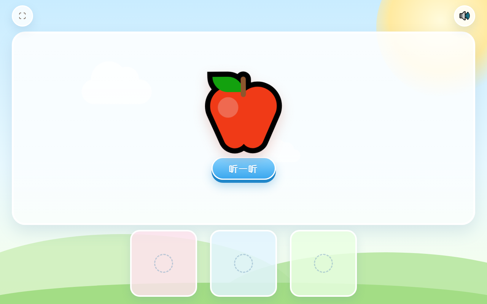

# 英语启蒙乐园 · lilearn-english

面向 3–6 岁幼儿的英语启蒙游戏基础框架。纯前端、单文件、可离线运行。

**在线体验：<https://lipinglabs.github.io/lilearn-english/>**



---

## 一、当前实现范围

| 需求 | 实现情况 |
| --- | --- |
| 纯前端单文件 HTML/JS/CSS | `index.html` 一个文件即全部功能，无任何外部请求 |
| 全屏显示、浅色卡通背景 | 天空渐变 + 太阳 + 漂移云朵 + 草地小山，`100dvh` 满屏无滚动，左上角可切换真全屏 |
| 页面中央大块显示区 | 中央白色半透明圆角面板，自适应占满剩余空间 |
| 下方三个选项按钮区 | 三个彩色方形槽位，空态显示虚线圆圈，已预置对外接口 |
| 右上角重播小喇叭 | 🔊 按钮，重播上一条语音；开场语音播放中点击会重播开场 |
| 页面不出现英文字母 | 页面可见文本仅「开始游戏」「听一听」与图标，已用无头浏览器断言校验 |
| 微软 TTS en-US-AnaNeural | 6 段语音全部由微软该音色合成，语速 -8% |
| 中央「开始游戏」按钮 | 点击播放开场语音 `Welcome to the English adventure! Let's play!` |
| 语音播完弹出苹果与测试按钮 | 播放结束后弹入 🍎 与「听一听」按钮，按钮重播该词语音 |

## 二、语音方案说明（重要）

语音由**微软 Edge TTS 的 `en-US-AnaNeural`（小女孩音色）**合成，但采用**构建期合成 + 内联**，而非浏览器运行时直连微软接口。原因是后者在技术上不可行：

1. 微软消费级朗读端点已强制校验 `Origin`，仅放行官方浏览器扩展来源，网页来源一律返回 `403`。
2. 鉴权要求 `Sec-MS-GEC` v2 令牌（`CS64 + 非标准初始化 SHA-256` 的复合摘要），且必须在握手时携带特定 `Cookie`——浏览器页面无法设置 WebSocket 自定义请求头与跨站 Cookie。

本项目对该结论做过实测：分别以扩展来源、网页来源、旧版令牌、v2 令牌、附加 Cookie 发起握手，均被 `403` 拒绝。

因此语音在开发阶段一次性生成并转为 base64 内联进页面，带来三个实际收益：

- **零延迟**：点击即出声，无网络往返，幼儿交互不会「等一下才响」。
- **离线可用**：断网、局域网、飞机上均可玩。
- **无密钥泄露**：不需要把 Azure 语音密钥放进公开页面。

若要改为「运行时任意文本合成」，正确做法是接 **Azure 语音服务官方 REST/SDK 并配置密钥**，且必须经由后端代理（密钥不可暴露在前端）。

## 三、本地预览

单文件，直接双击 `index.html` 即可。若需模拟线上环境：

```bash
python -m http.server 8000
# 打开 http://localhost:8000/
```

## 四、新增词条

1. 编辑 `tools/gen_voice.py` 中的 `PHRASES`，加一行 `"cat": "Cat. Cat.",`。
2. 运行：

```bash
pip install edge-tts
python tools/gen_voice.py
```

脚本会用 `en-US-AnaNeural` 重新合成全部语音，并自动注入 `index.html` 的语音库标记区间，`voice/` 目录同时保留 mp3 便于试听。

## 五、目录结构

```
index.html          单文件游戏（含全部样式、逻辑、内联语音）
voice/*.mp3         语音源文件（由脚本生成，便于试听与替换）
tools/gen_voice.py  语音合成与注入脚本
assets/preview.png  界面预览图
```

## 六、页面内对外接口

供后续扩展题目与关卡使用，控制台可直接调用：

```js
Game.speak('apple');              // 播放指定语音，返回是否存在
Game.showCard('🍌', 'banana');    // 中央显示任意 Emoji + 绑定语音
Game.hideCard();                  // 收起卡片
Game.setOption(0, '🍌', 'banana');// 填充第 1 个选项位
Game.clearOption(0);              // 清空选项位
Game.phase;                       // idle / playing / ready
Game.voiceKeys;                   // 当前可用语音键列表
```

## 七、兼容性与已知限制

- 音频播放受浏览器自动播放策略约束：首次播放必须由用户点击触发，本页面的「开始游戏」即充当该手势。
- 移动端建议「添加到主屏幕」后从桌面启动，可获得全屏无地址栏的体验；iOS Safari 不支持页面脚本全屏，需靠该方式。
- Emoji 外观取决于系统字体（Windows 为 Segoe UI Emoji，带黑色描边风格），不同设备略有差异，不影响功能。

---

本仓库为私人家庭教育用途，未附带开源许可证。
