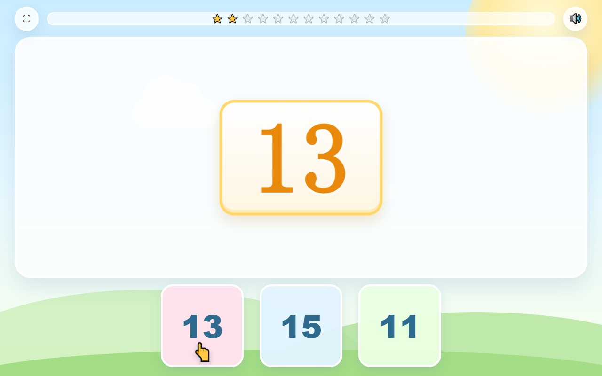
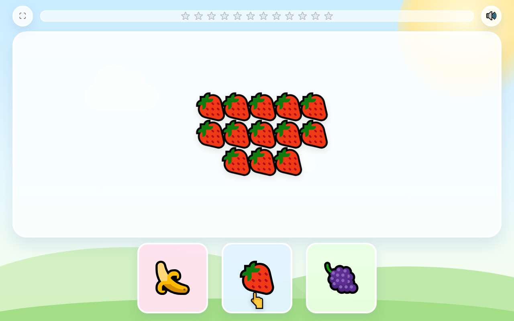

# 英语启蒙乐园 · lilearn-english

面向 3–6 岁幼儿的英语启蒙游戏。纯前端、单文件、可离线运行。
当前版本：**第一关「数字与水果」**（12 轮闯关）。

**在线体验：<https://lipinglabs.github.io/lilearn-english/>**

| 认读数字 | 数量指认 | 通关奖励 |
| --- | --- | --- |
|  |  |  |

---

## 一、第一关玩法

点「开始游戏」播放开场语音，随后进入 12 轮闯关。顶部 12 颗星星记录进度，每答对一轮亮起一颗。

### 三种题型（每轮随机，三种各出现 4 次，顺序打乱）

| 题型 | 屏幕内容 | 语音 | 选项 |
| --- | --- | --- | --- |
| 甲 · 认读数字 | 居中一个大数字（11–15） | 数字单词，如「Twelve」 | 三个数字 |
| 乙 · 数量与名词 | 一堆水果（11–15 个） | 水果名词复数，如「Apples」 | 三种不同水果 |
| 丙 · 数字与数量 | 目标水果 + 放大镜 | 「Find twelve apples」 | 三堆数量不同的同种水果 |

- 数字取 11–15，水果取 🍎🍌🍓🍇，相邻两轮不重复。
- **前 3 轮**正确选项下方有闪烁小手 👆 提示，第 4 轮起撤掉，改由孩子自己听音辨物。

### 反馈设计（保护自信心，不扣分）

- **答对**：选项放大发光 → 星星亮起 → 语音「Yes! Great job!」+ 紧跟该轮目标词（数字题补数字、名词题补名词）→ 自动进入下一轮。
- **答错**：选项抖动 → 语音「Oops, try again.」→ 不扣分、不跳轮，可原地重选，直到答对。
- 右上 🔊 随时重播本轮题干。

### 通关结算

12 轮后满屏彩带、金色奖杯 🏆 与语音「Wow! You did it! You are a math superstar!」，下方 🔄 可一键重开新一局（题目重新随机）。

## 二、语音方案说明（重要）

语音由**微软 Edge TTS 的 `en-US-AnaNeural`（小女孩音色）**合成，语速按用途分档（均在 -8% 至 -15% 区间）：提问 -11%、单词 -10%、夸奖 -8%。

采用**构建期合成 + base64 内联**，而非浏览器运行时直连微软接口。原因是后者在技术上不可行：

1. 微软消费级朗读端点已强制校验 `Origin`，仅放行官方浏览器扩展来源，网页来源一律 `403`。
2. 鉴权要求 `Sec-MS-GEC` v2 令牌（`CS64 + 非标准初始化 SHA-256` 的复合摘要），且必须在握手时携带特定 `Cookie`——浏览器页面无法设置 WebSocket 自定义请求头与跨站 Cookie。

本项目对该结论做过实测：分别以扩展来源、网页来源、旧版令牌、v2 令牌、附加 Cookie 发起握手，均被 `403` 拒绝。

内联带来的实际收益：**零延迟**（点击即出声）、**离线可用**、**无需在前端暴露密钥**。
若将来要做「任意文本实时合成」，正确路径是接 Azure 语音服务官方能力并配后端代理。

### 语音清单（33 条，579 KB，内联后约 0.74 MB base64）

| 类别 | 条数 | 内容 |
| --- | --- | --- |
| 开场 | 1 | Welcome to the English adventure! Let's play! |
| 数字 | 5 | Eleven / Twelve / Thirteen / Fourteen / Fifteen |
| 水果名词 | 4 | Apples / Bananas / Strawberries / Grapes |
| 指认句 | 20 | Find + 数字 + 水果（5×4 全组合） |
| 反馈 | 3 | Yes! Great job! / Oops, try again. / 通关祝贺 |

## 三、本地预览

单文件，直接双击 `index.html` 即可。若需模拟线上环境：

```bash
python -m http.server 8000
# 打开 http://localhost:8000/
```

## 四、新增或修改语音

1. 编辑 `tools/gen_voice.py` 中的 `PHRASES`（键 → 文本 + 语速）。
2. 重新合成并注入页面：

```bash
pip install edge-tts
python tools/gen_voice.py
```

只改了页面结构、语音没变时，用「仅注入」模式复用已有 mp3，不必重新合成：

```bash
python tools/gen_voice.py --inject-only
```

脚本会自动清理 `voice/` 中已不再使用的旧音频。

## 五、目录结构

```
index.html          单文件游戏（全部样式、逻辑、内联语音）
voice/*.mp3         33 条语音源文件（由脚本生成，便于试听）
tools/gen_voice.py  语音合成与注入脚本
assets/*.png        界面预览图
```

## 六、页面内对外接口

```js
Game.snapshot();   // 当前状态：轮次、星星、题型、数字、水果、正确选项
Game.say(['yes']); // 顺序播放指定语音
Game.restart();    // 重开一局
Game.phase;        // idle / intro / asking / judging / done
Game.voiceKeys;    // 可用语音键列表
```

## 七、自动化验证记录

用无头 Edge + CDP 驱动真实页面（音频以桩替代，保证时序确定）跑完整通关：

- 连续 12 轮答对并通关，星星 12/12、奖杯与 100 片彩带正常，无卡死；
- 每轮先点错答案：抖动出现、星星不加、轮次不跳、状态回到可作答；
- 提示小手仅出现在第 1–3 轮，第 4 轮起为 0 个；
- 题型分布 4/4/4，相邻轮数字无重复；
- 通关后 🔄 重开：轮次归零、星星清空、彩带清除；
- 桌面 1280×800 与手机 390×844 双视口均无横向/纵向溢出；
- 页面可见文本不含任何英文字母；控制台无报错。

## 八、兼容性与已知限制

- 音频播放受浏览器自动播放策略约束：首次播放必须由用户点击触发，「开始游戏」即充当该手势。
- 移动端建议「添加到主屏幕」后从桌面启动，可获得无地址栏的全屏体验；iOS Safari 不支持页面脚本全屏。
- Emoji 外观取决于系统字体（Windows 为 Segoe UI Emoji，带黑色描边风格），不同设备略有差异，不影响功能。

---

本仓库为私人家庭教育用途，未附带开源许可证。
