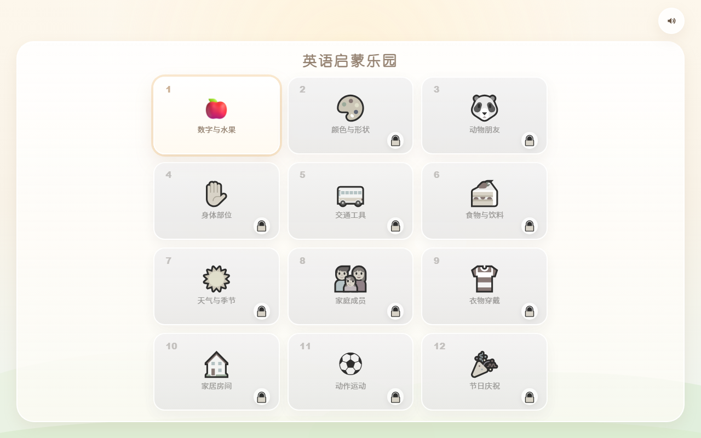
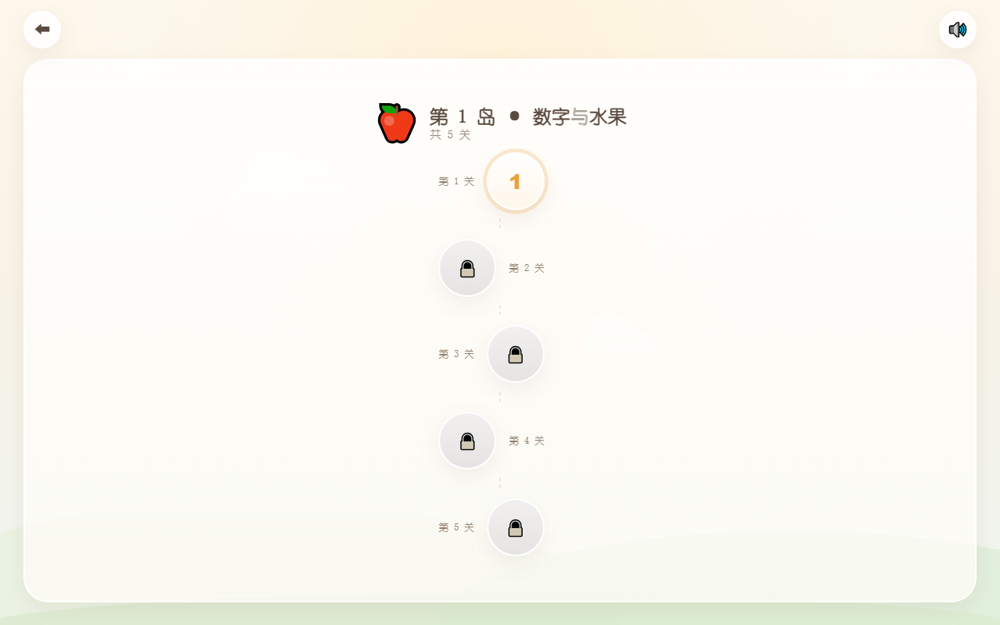
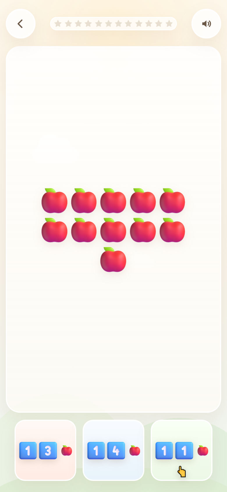

# 英语启蒙乐园 · lilearn-english

面向 3–6 岁幼儿的英语启蒙游戏。纯前端、单文件、可离线运行。
当前进度：**12 岛 × 5 关框架 + 第 1 岛 5 关 + 第 2 岛第 1 关（基础形状）已完成**。

**在线体验：<https://lipinglabs.github.io/lilearn-english/>**

> 开发铁律见 [RULES.md](RULES.md)，改动前必读。

| 闯关地图 | 岛屿内页 | 关卡（方案 B） | 通关奖励 |
| --- | --- | --- | --- |
|  |  |  |  |

---

## 一、闯关地图框架

- 地图共 **12 个岛屿**（对应 12 个月主题）：数字与水果、颜色与形状、动物朋友、身体部位、交通工具、食物与饮料、天气与季节、家庭成员、衣物穿戴、家居房间、动作运动、节日庆祝。
- 每个岛内 **5 关**（第 1 关 … 第 5 关）。
- 初始只有「第 1 岛 · 第 1 关」可玩，其余全部灰化并带 🔒；点击未解锁的任何内容都会播放英文 `Coming soon!`，不跳转、不报错。
- 解锁严格前置：通关第 N 关解锁同岛第 N+1 关；通关某岛第 5 关才解锁下一个岛。
- 进度写入 `localStorage`（键 `lilearn.progress.v1`），刷新、关掉浏览器都不会丢。

## 二、第 1 岛第 1 关「数字与水果」

12 轮闯关，三种题型各 4 次、顺序随机且相邻不重复，数字 11–15、水果 🍎🍌🍓🍇 随机变化。

| 题型 | 屏幕显示 | 语音 | 选项 |
| --- | --- | --- | --- |
| 甲 · 听数字找数量 | **一堆水果**（11–15 个，需自己数） | 数字单词，如「Fourteen」 | 三个 **3D 数字标牌**，牌旁配小水果图标 |
| 乙 · 数量与名词 | 一堆水果 | 水果名词复数，如「Apples」 | 三种水果 |
| 丙 · 数字与数量 | 目标水果 + 🔍 | 「Find twelve apples」 | 三堆同种水果，每堆配 **3D 数字标牌**（方案 B） |

> 甲题不再是"听数字找数字"——屏幕上是果堆、只有声音给数字，孩子必须自己数出数量再去找对应的数字标牌。

- 前 3 轮正确选项下方有闪烁小手 👆，第 4 轮起撤除。
- **题库随机**：每局由生成器重新抽题（数字 11–15 × 水果 4 种），同一局内不出现重复的「数字+水果」组合；选项顺序每局重排，**答错后也会重新洗牌**，避免靠记位置通关。
- **答对：完全没有语音**。选项放大发光 → 金币音「叮咚」→ 一颗金色星星飞入顶部进度条（弹性缩放）→ 落位一声轻 ting → **430ms 内进入下一题**。
- **答错**：选项抖动 + 轻微提示音「Oops, try again.」，不扣分、不跳轮，可原地重选。
- **通关**：满屏彩带 + 3D 奖杯 + 调用 `playRandomPraise()` 播放中文鼓励，再播英文祝贺；下方重开键可开新一局。


## 二·B、第 1 岛第 2 关「16–20 与数量」

12 轮闯关，三种题型混合随机，数字 16–20、水果 🍎🍌🍓🍇 随机变化，每局重新抽题、答错重洗牌。

| 题型 | 屏幕显示 | 语音 | 选项 |
| --- | --- | --- | --- |
| A · 听音找数量组 | 「仔细听」大喇叭 | 数字单词，如「Sixteen」 | 三个**十格阵**果堆（10 个一组 + 零头，如 16 = 10+6） |
| B · 听短句找水果标牌 | 目标水果 + 🔍 | 「Find seventeen bananas.」 | 三张 **3D 数字标牌**（如 17/19/16），右下角小水果图标 |
| C · 数字喂食机 | **3D 卡通小怪兽**，肚子挂数字牌（如 20） | 「Feed me twenty strawberries.」 | 三堆松散草莓（约 5 / 约 20 / 约 35），凭**视觉估数**选出对的那堆喂怪兽 |

- 无新手提示（小手只在第 1 关前 3 轮出现）。
- 答对：金币音 + 星星飞入，无任何人声；答错：抖动 + 「Oops, try again.」并重洗选项。
- 通关 `playRandomPraise()` 随机中文女童音鼓励；通关第 2 关后才解锁第 3 关。


## 二·C、第 1 岛第 3 关「21–29 与短句组合」

12 轮闯关，三种题型混合随机；数字 21–29、水果随机，每局重新抽题、答错重洗牌、无新手小手提示。

| 题型 | 屏幕显示 | 语音 | 选项 |
| --- | --- | --- | --- |
| A · 两位数连读 | 「仔细听」大喇叭 | 「Twenty-four.」 | 三个**巨大 3D 数字底板**（如 21 / 24 / 28） |
| B · 听短句找组合 | **完全空白** | 「Find two apples.」 | 三张组合图：2 个苹果 / 3 根香蕉 / 4 颗草莓（数量各不相同） |
| C · 数数大挑战 | 中央**十格阵**果堆（25 = 10+10+5） | 「How many strawberries?」→「Twenty-five.」 | 三个 3D 数字底板（如 24 / 25 / 26） |

> **复合数字铁律（RULES §1.10）**：语音文本里 21–29 一律写成 `Twenty-one` … `Twenty-nine`，
> 绝不出现阿拉伯数字——否则 TTS 会读成 "two one"，破坏连读节奏。脚本 `audit()` 会对每条英文文本做
> `/[0-9]/` 校验，一出现数字就直接判自检失败、拒绝合成。


## 二·D、第 1 岛第 4 关「颜色初体验」

12 轮闯关，三种题型混合随机；颜色红/蓝/黄/绿，每局重新抽题、答错重洗牌、无新手小手提示。

| 题型 | 屏幕显示 | 语音 | 选项 |
| --- | --- | --- | --- |
| A · 听音找颜色 | 「仔细听」大喇叭 | 「Red.」 | 三个不同颜色的 **3D 气球** |
| B · 听短句找物品 | 「仔细听」大喇叭 | 「Find the red apple.」 | 三个**同形状异颜色**的红/蓝/黄/绿苹果 |
| C · 颜色与物品匹配 | 中央一个**灰色 3D 物品**（汽车/气球） | 「Make the car red.」 | 三个圆润 **3D 颜色按钮**；选对后物品当场刷成该颜色 + 音效 |

**染色素材**：`tools/make_colors.py` 用色相替换（只改「本体色相带」）从 Fluent 3D 原图生成
红/蓝/黄/绿四色 + 灰色版本，叶子、果柄、车窗、轮胎、车灯原样保留，输出 `assets/color/*.png`
（`apple_blue` / `car_gray` 等），构建期内联进 `window.COLOR_IMG`。


## 二·E、第 1 岛第 5 关「游乐场：终极考验」（拖拽关）

12 轮，三种题型混合随机，综合运用数字 10–29、水果与颜色。**本关是第 1 岛结业考**。

| 题型 | 交互 | 屏幕 | 语音 |
| --- | --- | --- | --- |
| A · 喂小怪兽 | **拖果篮**到怪兽（或直接点篮子） | 中央 3D 小怪兽肚子上挂数字（如 18），下方三个藤编小篮各装**十格阵**果堆（12/18/22） | 「Feed me eighteen apples.」 |
| B · 颜色分类 | **拖水果**进同色篮子（或点水果再点篮子） | 上方托盘 3 个**彩色 3D 水果**（红苹果/蓝草莓/蓝葡萄…，会故意放两个同色异果），下方红蓝黄三个编织篮 | 「Put the blue grape in the blue basket.」 |
| C · 听指令找组合 | 直接点卡片 | 三张大卡片，各画 N 个同色苹果（如 3 红 / 4 蓝 / 2 红） | 「Find three red apples.」 |

- 拖拽手感：跟随时轻微放大（`scale(1.1)`）+ 阴影，目标篮子高亮 `drop-hot`，松手后**吸附**到目标中心并缩放入篮，同时叮咚声。
- 判定：A 看篮子数量；B **水果与篮子颜色都要对**；C 看卡片。
- 答对只出星星（无人声），答错温柔女声 + 重洗。
- **通关整岛**：200 片碎彩带 + 26 枚金色亮片（从中心向两侧飞），奖杯区右上角升起通关小旗，
  返回地图后第 1 岛带光环与旗标、第 2 岛解锁。


## 二·F、云存档（跨设备进度同步）

之前的进度只存在浏览器 `localStorage`，换个设备、或换一个浏览器内核（比如微信内置浏览器），
进度就看不到——这才是「进度老是重置」的真正原因。现在加了云存档：

- 存档放在**私有 Gist**（文件名 `lilearn-progress.json`，描述 `lilearn-english-save`），
  第一次点击「连接云存档」时自动创建，之后两台设备共用同一份。
- 启动时先拉云端与本地合并再渲染地图；每次通关立刻回写云端。
- 合并规则：通关记录取并集、解锁关卡取最远、星星取最高分——任何一台设备的进度都不会被另一台覆盖。
- 网络失败只把云图标变红，本地照常保存，下一次通关自动重试，不会卡住游戏。

**首次设置（每台设备一次）**：点右上角云朵图标 → 粘贴访问令牌 → 连接云存档。
令牌只保存在这台设备的浏览器里，不会写进网页或仓库。


## 二·G、第 2 岛第 1 关「基础形状」

第 2 岛「形状与空间」的入口关。12 轮混合随机，四种形状：**圆形 / 正方形 / 三角形 / 长方形**。

| 题型 | 屏幕 | 语音 | 选项 |
| --- | --- | --- | --- |
| A · 听音找形状 | 「仔细听」 | 「Find the circle.」 | 三个纯色 3D 形状（颜色每局随机，防止靠颜色记答案） |
| B · 生活物品联想 | 「仔细听」 | 「Where is the triangle?」 | 披萨（圆）/ 窗户（方）/ 西瓜片（三角）/ 门（长方形） |
| C · 图形拼搭 | 一栋小屋：三角屋顶 + 方形墙 + 圆形窗 + 长方形门 | 「Find the square.」 | 三个形状按钮；点对后房子里对应的那一块会发光 |

- 形状、生活物品、房子全部是**手写 SVG**（渐变 + 高光 + 柔投影），圆角与曲线处理过，
  没有生硬直角描边；不引入新的位图素材。
- 题库有 4 种形状但选项栏只有 3 个槽位 → 每题抽「正确形状 + 2 个干扰形状」（RULES §二.11）。
- 答对只出星星（无人声），答错抖动 + 温柔女声 + 重洗。


## 二·H、英文通关夸奖：与学科无关（RULES §1.11）

早期版本把通关英文写死成一句带 **math** 的夸奖。第 1 岛是数字没问题，但第 2 岛是形状、
以后还有动物岛，再喊数学就完全不合理。现在已彻底解绑：

- 固定 3 句通用语，**每次通关随机播一句、且不连续重复**：
  `Awesome! Level complete!` / `Wow! You are a superstar!` / `Fantastic! You did it!`
- 播放入口唯一：`playLevelComplete()`（挂在 `window.playLevelComplete`）；
  通关流程统一为 `playRandomPraise(playLevelComplete)` —— 先中文女童音随机鼓励，再英文通用夸奖。
- **所有岛、所有关卡共用这一套**，新增关卡不必再生成通关语音（省额度）。
- `audit()` 增加机器校验：英文文本里出现 `math/maths/mathematics` 直接判自检失败、拒绝合成。

## 三、语音方案

全部语音由**豆包语音合成大模型 2.0**生成后以 base64 内联，共 **174 条**（英文 168 + 中文 6），页面运行时不请求任何接口。文本清单与状态见 `voice/manifest.md`（由 `tools/gen_voice_doubao.py` 自动生成）。

| 用途 | 音色 | 控制方式 |
| --- | --- | --- |
| 英文全部语音 | `en_female_allison_uranus_bigtts` | `context_texts` 情绪指令（温柔/兴奋两套） |
| 中文通关鼓励 | `zh_female_xiaoxue_uranus_bigtts`（儿童绘本 2.0）+ 音调 +3 + 48kHz/160kbps | `context_texts` 强情绪指令（放在 `additions` 内） |

中文鼓励固定 6 句，由全局函数 `playRandomPraise()` 随机播放，且不会连续重复同一句：

1. 李旻泽，你真棒
2. 李旻泽，你又过了一关
3. 李旻泽，你又进步了一点点
4. 李旻泽，这都难不倒你呀
5. 李旻泽，给你一个大大的赞
6. 李旻泽，接下来也要保持这么棒哦

### 为什么是构建期生成而不是浏览器实时调用

1. 浏览器直连会把 API Key 暴露在公开网页上；
2. 火山这类语音端点不开放跨域，网页端调用会被拦；
3. 内联音频零延迟、断网可玩，适合幼儿交互。

需要「任意文本实时合成」时，必须另建后端代理，密钥只放服务端。

### 关于豆包输出的随机性（重要）

同一段文本、同一音色、同一参数，连续两次生成的音频**并不相同**（实测字节数相差 12%）。因此：

- 批量生成只做一次，`tools/gen_voice_doubao.py` 默认跳过已存在的 mp3；重做要显式 `--force`。
- 严禁用文件大小判断参数是否生效，只能靠听感对比。

## 四、目录结构

```
index.html                 单文件应用（地图 + 岛屿 + 关卡 + 内联语音 + 内联 3D 图，约 1.4 MB）
RULES.md                   开发铁律
voice/*.mp3                174 条语音源文件（豆包 2.0 生成）
assets/fruit/*.png         10 张 3D 图标（4 水果 + 奖杯 + 数字 1–5，微软 Fluent Emoji 3D，MIT）
assets/*.png               界面预览图
tools/gen_voice_doubao.py  批量合成 + 注入页面
tools/inline_assets.py     3D 图标内联
```

## 五、重新生成语音

```bash
set DOUBAO_API_KEY=<你的Key>
python tools/gen_voice_doubao.py                 # 生成缺失项并注入
python tools/gen_voice_doubao.py --inject-only   # 只注入，不合成
python tools/gen_voice_doubao.py --force --only n11 n12   # 强制重做指定条目
```

脚本会先预检中文音色是否可用（不可用则自动回退到甜美小源/邻家女孩），任一条目失败就中止且不注入，已成功的条目下次自动跳过。

## 六、对外接口

```js
Game.snapshot();          // 当前状态：视图、轮次、星星、题型、进度
Game.openIsland(2);       // 打开指定岛屿
Game.backToMap();         // 回到地图
Game.markCleared(1, 5);   // 标记通关（测试解锁链路用）
Game.resetProgress();     // 清空存档
window.playRandomPraise();// 全局中文鼓励（每次通关必须调用）
Game.phase;               // idle / intro / asking / judging / done
```

## 七、自动化验证记录

用无头 Edge + CDP 驱动真实页面（音频以桩替代，保证时序确定），桌面 1280×800 与手机 390×844 双视口均通过：

- 地图 12 岛、11 个锁定、仅第 1 岛可进入；点锁定岛播放 `coming` 且不跳转；
- 岛屿内页 5 节点、4 个锁定、第 1 关可玩；点锁定节点播放 `coming`；
- 连续 12 轮答对通关，星星 12/12 逐颗飞入点亮（连跑两次均 12/12），飞星元素与 AudioContext 均实际创建；
- **答对全程 0 语音**：完整播放日志中 `yes` / `star` 出现次数为 0，只有题干与通关鼓励；
- 错答：抖动出现、星星不加、轮次不跳、只播 `again`；
- 星星为 12 个 `svg.star`（含 path），星星条内无任何文字残留；水果/奖杯/数字均为 `img` 内联图；
- 连跑 3 局：题型序列、数字序列、选项排列三局互不相同；每局 12 题的「数字+水果」组合去重 12/12；
- 甲题结构断言：果堆图数 == 题目数字，三个选项均为数字标牌（每块 2 枚数字图 + 1 枚水果图标），屏幕中央无纯文本数字；
- 答错后选项顺序确实改变且仍停留原轮；
- 通关：彩带 90 片、🏆 显示、`praise_*` 与 `win` 均播放、进度写入 `cleared["1-1"]` 并解锁第 2 关；
- 解锁链路：通关第 1 关后第 2 关解锁、第 2 岛仍锁；标记通关第 5 关后第 2 岛解锁；刷新页面进度保留；
- 三个视图均无英文字母（含 `aria-label`）、无滚动溢出、控制台无报错；
- 174 条语音全部可在浏览器解码。

## 八、已知限制

- 单文件 1.4 MB（41 条语音 + 5 张 3D 图全部内联），首次加载略大，之后走浏览器缓存。
- 语音播放受浏览器自动播放策略约束，首次播放必须由点击触发（「开始游戏」即该手势）。
- 移动端建议「添加到主屏幕」启动以获得无地址栏全屏；iOS Safari 不支持页面脚本全屏。
- Emoji 外观取决于系统字体（Windows 为 Segoe UI Emoji，带黑色描边风格），不同设备略有差异。
- 目前只有第 1 岛第 1 关有内容，其余关卡提示「还在准备中」。

---

本仓库为私人家庭教育用途，未附带开源许可证。
